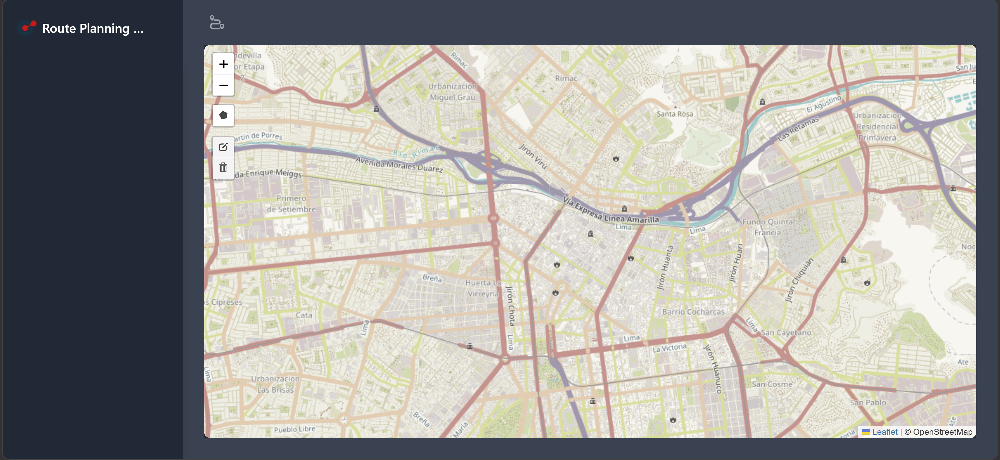
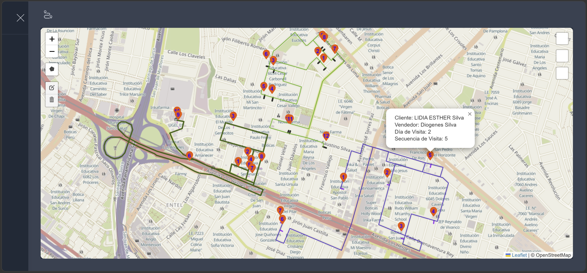
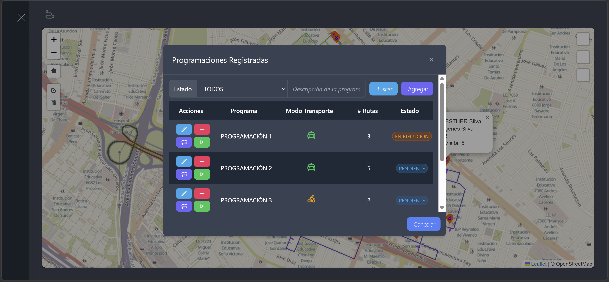

# Geographic Route Planning System

**Customer Clustering, Geographic Route Planning and Visit Sequencing**


## Overview

Geographic Route Planning System is an ASP.NET Core MVC web application designed to organize geographically distributed customers into configurable groups and assign visit sequences within each group.

The application implements a K-Means-inspired geographic clustering approach using Haversine distance, iterative centroid updates, and centroid-distance-based visit sequencing.

Generated groups and visit sequences can be visualized on an interactive map and persisted in Microsoft SQL Server.

The project demonstrates algorithmic problem-solving, geospatial data processing, layered application architecture, and database integration using C#.

## Problem Statement

Organizations managing geographically distributed customers need practical tools to organize service territories and establish visit schedules.

Manually grouping customers by location can become inefficient as the number of customers increases.

This application addresses that challenge by:

- Organizing customers into geographically related groups.
- Calculating geographic distances using the Haversine formula.
- Updating cluster centers through iterative calculations.
- Assigning visit sequences within each group.
- Visualizing the results on an interactive map.
- Persisting the generated planning information in SQL Server.

The system provides geographic grouping and visit sequencing. It does not claim to calculate globally optimal travel routes.

## Key Features

### Geographic Customer Clustering

- Group customers according to geographic coordinates.
- Configure the number of groups used in a clustering operation.
- Calculate geographic distances using the Haversine formula.
- Update cluster centers iteratively.
- Organize customers into geographically related groups.

### Visit Sequencing

- Initialize customer visit sequences for each group.
- Sort customers according to their distance from the cluster center.
- Assign consecutive visit sequence identifiers.
- Maintain separate visit sequences for each group.

### Geographic Visualization

- Display customer groups on an interactive map.
- Visualize geographic customer locations.
- Display assigned visit sequences.
- Support geographic interpretation of the generated groups.

### SQL Server Integration

- Retrieve customer and planning information.
- Execute database operations through a repository layer.
- Use SQL Server stored procedures.
- Persist generated groups and visit sequences.

## Technology Stack

| Technology | Purpose |
|---|---|
| C# | Application and algorithm implementation |
| ASP.NET Core MVC | Web application framework |
| .NET | Application runtime |
| SQL Server | Data persistence |
| Dapper | Database query execution |
| Leaflet | Interactive geographic visualization |
| Haversine Formula | Geographic distance calculation |
| Geographic Clustering | Customer grouping |
| Razor Views | Server-rendered user interface |

## Application Architecture

The application is organized into four projects within a .NET solution.

```text
                  User
                   |
            ASP.NET Core MVC
                   |
          Fast.Route.UserInterface
                   |
          Fast.Route.Logic
                   |
          Fast.Route.Models
                   |
          Fast.Route.Repository
                   |
                Dapper
                   |
              SQL Server
```

This diagram represents the conceptual flow of the application. Actual project dependencies are defined by the solution's project references.

### Project Structure

```text
route-planning-system/
├── Fast.Route.Logic/
│   ├── BikerLogic.cs
│   └── Fast.Route.Logic.csproj
│
├── Fast.Route.Models/
│   ├── App/
│   ├── Biker/
│   ├── Client/
│   ├── Common/
│   ├── Program/
│   ├── RouteSequence/
│   │   ├── AdvancedMarkerModel.cs
│   │   ├── ClusterModel.cs
│   │   ├── CoordinatesModel.cs
│   │   ├── LocationModel.cs
│   │   └── PointModel.cs
│   ├── AppSettings.cs
│   └── Fast.Route.Models.csproj
│
├── Fast.Route.Repository/
│   ├── BaseRepository.cs
│   ├── BikerRepository.cs
│   ├── ClientRepository.cs
│   └── Fast.Route.Repository.csproj
│
├── Fast.Route.UserInterface/
│   ├── Controllers/
│   ├── Properties/
│   ├── Views/
│   ├── wwwroot/
│   ├── Program.cs
│   ├── appsettings.json
│   └── Fast.Route.UserInterface.csproj
│
├── Fast.Route.sln
├── .gitignore
└── README.md
```

### Layer Responsibilities

**UserInterface:** ASP.NET Core MVC controllers, Razor views, application configuration, and map presentation.

**Logic:** Application business logic and route-planning operations.

**Models:** Customer, cluster, geographic coordinate, and visit-sequence data structures.

**Repository:** SQL Server data access and stored procedure execution.

## Geographic Clustering Algorithm

The application uses a geographic clustering approach inspired by K-Means.

### 1. Input Data

Each customer is associated with geographic coordinates:

```text
UniqueId
IdentificationId
IdentificationName
Name
Address
Lat
Lng
```

The algorithm receives:

- A collection of geolocated customers.
- A configurable number of groups.
- A configured number of clustering iterations.

### 2. Haversine Distance

The Haversine formula estimates the great-circle distance between two geographic coordinates.

For two points with latitude and longitude \((\varphi_1,\lambda_1)\) and \((\varphi_2,\lambda_2)\):

$$
a = \sin^2\left(\frac{\Delta\varphi}{2}\right) + \cos(\varphi_1)\cos(\varphi_2)\sin^2\left(\frac{\Delta\lambda}{2}\right)
$$

$$
d = 2R\arcsin(\sqrt{a})
$$

Where:

- \(R\) is the Earth's approximate radius.
- \(\varphi\) represents latitude in radians.
- \(\lambda\) represents longitude in radians.
- \(d\) is the estimated geographic distance.

This metric is used for geographic proximity calculations.

### 3. Cluster Assignment

Customers are assigned to geographic groups based on their distance to the cluster centers.

The number of groups is configurable.

An example clustering operation is:

```csharp
var clusters = new Kmeans(
    clients, 
    NumberOfRoutes, 
    Haversine, 
    iterations, 
    NumberOfClients
    );
```

In this example:

- `clients` contains customer coordinates.
- `NumberOfRoutes` represents the requested number of groups (4).
- `iterations` controls the number of centroid update iterations.
- `NumberOfClients` the number of customers for each group (To be updated).

### 4. Centroid Updates

During clustering, each group center is recalculated using the average latitude and longitude of its assigned customers.

For a group containing \(n\) customers:

$$
\overline{\varphi} = \frac{1}{n}\sum_{i=1}^{n}\varphi_i
$$

$$
\overline{\lambda} = \frac{1}{n}\sum_{i=1}^{n}\lambda_i
$$

The assignment and centroid update process is repeated according to the configured iteration count.

The implementation uses geographic distance for assignment and coordinate averaging for centroid updates.

## Visit Sequencing

After customer groups have been generated, the application assigns a visit sequence within each group.

### Sequencing Procedure

1. Retrieve the customers assigned to a group.
2. Initialize each customer's sequence to `-1`.
3. Sort the group using the distance-to-centroid value.
4. Assign consecutive sequence identifiers starting from `1`.
5. Repeat for every group.

### Simplified C# Example

```csharp
foreach (var cluster in clusters)
{
    var points = cluster.Select(client => new SequenceModel
    {
        Coordinate = cluster.Coordinate,
        ResourceId = cluster.ResourceId,
        Sequence = -1,
        CentroDistanceId = client.CentroDistanceId
    }).ToList();

    points.Sort();

    int sequenceId = 1;

    foreach (var point in points)
    {
        point.Sequence = sequenceId++;
    }
}
```

The ordering behavior is defined by the `SequenceModel` comparison implementation.

When the sequence is initialized to `-1`, customers are compared using their `CentroDistanceId` values.

### Example Result

The following data is illustrative:

| Group | Customer | Distance to centroid | Visit sequence |
|---|---|---|---|
| 1 | Customer A | 0.8 km | 1 |
| 1 | Customer B | 1.4 km | 2 |
| 1 | Customer C | 2.1 km | 3 |
| 2 | Customer D | 0.5 km | 1 |
| 2 | Customer E | 1.7 km | 2 |

Visit sequences restart for each group.

### Algorithm Limitations

The sequencing method orders customers according to their distance from the cluster center.

It does not necessarily minimize the total distance traveled between consecutive customers.

Haversine distance estimates geographic distance rather than actual road-network travel distance.

Possible future improvements include nearest-neighbor sequencing, 2-opt refinement, and road-network-based routing.

## Geographic Visualization and Persistence

The resulting customer groups and visit sequences are displayed through the application's map interface.

Generated planning information is also stored in SQL Server through the application's data access layer.

This allows the system to combine geographic visualization with persistent planning records.

## Getting Started

### Prerequisites

- .NET SDK compatible with the target framework specified in the project files.
- Microsoft SQL Server.
- Git.
- Required database schema and stored procedures.

### 1. Clone the Repository

```bash
git clone https://github.com/pablotorressanchez/route-planning-system.git
cd route-planning-system
```

### 2. Restore Dependencies

```bash
dotnet restore Fast.Route.sln
```

### 3. Configure SQL Server Connection

The application uses the `AppSettings` configuration section.

The public `appsettings.json` should not contain real database credentials.

Initialize .NET User Secrets:

```bash
dotnet user-secrets init --project Fast.Route.UserInterface
```

If User Secrets have already been initialized for the project, this step is unnecessary.

Configure the local connection string:

```bash
dotnet user-secrets set \
  "AppSettings:ConnectionString" \
  "YOUR_LOCAL_CONNECTION_STRING" \
  --project Fast.Route.UserInterface
```

Replace the placeholder with a valid local connection string.

Avoid storing production credentials in source code or committing them to Git. Entering credentials directly in a shell command may expose them in command history.

### 4. Build the Solution

```bash
dotnet build Fast.Route.sln
```

### 5. Run the Application

```bash
dotnet run --project Fast.Route.UserInterface
```

Open the local application URL displayed in the terminal.

### Database Requirements

The application depends on SQL Server stored procedures and database objects.

A compatible database must be configured before executing database-dependent features.

The repository does not currently include a verified standalone database initialization or seed-data workflow.

## Screenshots

Screenshots should use synthetic or anonymized customer data.

### Main Application



### Customer Geographic Distribution

*Screenshot placeholder — Customer markers displayed on Leaflet.*

### Geographic Clustering

*Screenshot placeholder — Customers assigned to geographic groups.*

### Visit Sequencing



### Planning Results




Suggested directory:

```text
docs/screenshots/
```

## Future Improvements

Potential enhancements include:

- Road-network-aware route optimization.
- Nearest-neighbor or 2-opt sequencing.
- Configurable clustering convergence criteria.
- Automated unit and integration tests.
- Synthetic demonstration datasets.
- Database initialization scripts.
- Performance evaluation for larger customer datasets.

These are proposed improvements, not claims about currently implemented functionality.

## Project Status

Portfolio project demonstrating:

- ASP.NET Core MVC development.
- Layered C# application architecture.
- Geographic clustering algorithms.
- Haversine distance calculations.
- Iterative centroid updates.
- Customer visit sequencing.
- Leaflet-based map visualization.
- SQL Server persistence using stored procedures.

## Author

GitHub: [pablotorressanchez](https://github.com/pablotorressanchez)
